Software engineer working on deep learning and LLMs. My grad research was on anomaly detection for medical images.

**Now** · Kaggle *Name That LLM*, figuring out which model wrote a given text.

**Selected**

- NCSP'25 Student Paper Award for *Anomaly Detection for PET Images Using Self-Attention PatchCore with Normalizing Flow*
- Kaggle Competitions Expert, 2 bronze medals
- SIGNATE Expert, 2 silver and 2 bronze medals, peak rank 338 of 200k+ users
- Contributor to 深層学習教科書 ディープラーニング E資格（エンジニア）精選問題集

**Stack**

[Kaggle](https://www.kaggle.com/kurapuchi) · [SIGNATE](https://signate.jp/users/109790)
